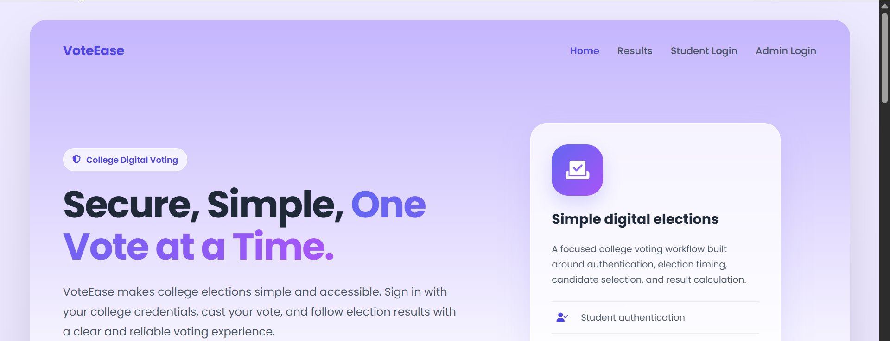
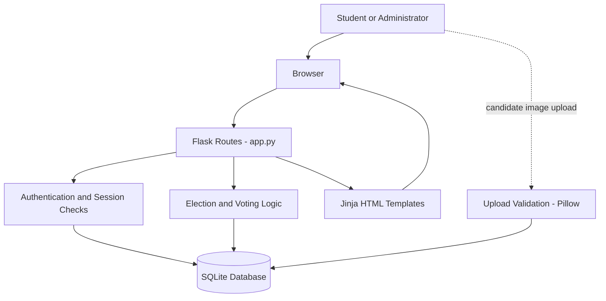
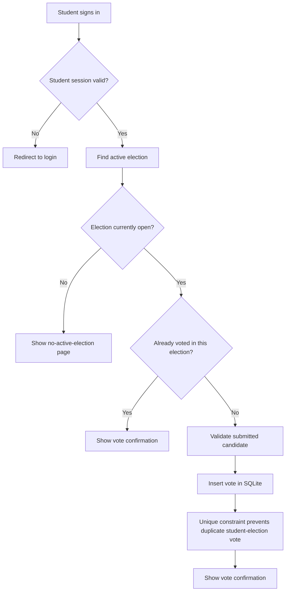

<div align="center">

# 🗳️ VoteEase

### Mini Online Voting System

A Flask-powered college election app for student registration, time-controlled elections, candidate management, and vote counting.

<p>
  <a href="https://github.com/aman-matoliya-dev/VoteEase"></a>
  
  
  
</p>

[Live Demo](https://aman5.pythonanywhere.com/home) · [Report a Bug](https://github.com/aman-matoliya-dev/VoteEase/issues) · [Source Code](https://github.com/aman-matoliya-dev/VoteEase)

</div>

---

## 📸 Interface Preview

<p align="center">
  
</p>

<p align="center"><em>VoteEase homepage — a clean, responsive interface for a college voting workflow.</em></p>

## 📖 About the Project

VoteEase is a college-level **Problem-Based Learning (PBL)** project built with **Python, Flask, SQLite, HTML, CSS, Bootstrap, and Jinja templates**. It demonstrates how a web application can manage a basic election lifecycle: students create accounts and sign in, an administrator creates an election and manages candidates, eligible students cast votes, and the application calculates results after voting closes.

The project is intended for learning and demonstration. It is **not a certified or independently audited election platform** and should not be used for high-stakes elections without further security, integrity, and operational work.

## ✨ Features

### 🎓 Student workflow

- Register using a College ID and password.
- Sign in with password-hash verification.
- View the current voting opportunity when an election is active.
- Select a candidate and submit a vote.
- Enforce one vote per student per election with a SQLite uniqueness constraint.
- Show a confirmation page after vote submission.
- Display the latest election's result after it has ended.

### 🛠️ Admin workflow

- Admin login using a password configured through an environment variable.
- Create an election with a duration in minutes.
- Add candidates with image uploads.
- View vote counts and student voting status during an active election.
- Delete candidates or student records.
- End an active election manually.

### 🔐 Security controls currently present

- Student passwords are hashed with Werkzeug utilities.
- SQL queries generally use parameterized values.
- Flask-WTF CSRF protection is enabled for form submissions.
- Session cookies are configured with `HttpOnly`, `Secure`, and `SameSite=Lax` attributes.
- Candidate uploads have extension checks, Pillow image verification, filename sanitization, and a 5 MB request-size limit.
- Responses receive a `Cache-Control: no-store` header.
- `SECRET_KEY` and `ADMIN_PASS` are read from environment variables.

> These are existing safeguards, not a guarantee that the application is fully secure. See [Known limitations](#-known-limitations--next-steps) before deployment.

## 🧰 Tech Stack

| Layer | Technology | Purpose |
|---|---|---|
| Backend | Python, Flask | Routes, sessions, validation, and election logic |
| Templates | Jinja | Server-rendered HTML pages |
| Frontend | HTML, CSS, JavaScript, Bootstrap 5 | Layout, forms, styling, and countdown timers |
| Database | SQLite | Students, elections, candidates, and votes |
| Security | Flask-WTF, Werkzeug | CSRF protection and password hashing |
| Image handling | Pillow | Verify uploaded candidate images |
| Deployment | PythonAnywhere (configured deployment) | Hosting the Flask application |

## 🏗️ Architecture

The current application uses a straightforward server-rendered architecture. Most route and business logic lives in `app.py`; database connections and password helpers are separated into small utility modules.



### Vote submission flow



**Important implementation note:** candidate-to-election validation is an identified improvement area in the current vote handler. The diagram's validation step describes the desired safe workflow; it should not be read as confirmation that this check is fully implemented today.

## 🔄 Election lifecycle

1. An administrator signs in and creates an election with a duration.
2. The administrator adds candidates and their images.
3. A student registers or signs in.
4. While an election is active and within its time window, the student can select a candidate and submit a vote.
5. The database's unique `(election_id, student_id)` constraint helps prevent a second vote for the same election.
6. The election can end when its time expires or an administrator ends it.
7. The results page displays the latest election's result after it is marked inactive.

The current results page shows the selected winner and their vote count rather than a full table of every candidate's totals. Tie and zero-vote winner handling also need improvement.

## 📁 Project Structure

```text
VoteEase/
├── app.py                     # Flask application and route handlers
├── requirements.txt           # Current pinned Python dependencies
├── CHANGES.md                 # Upgrade notes and deployment notes
├── googlec246928b39a849e4.html # Search-engine ownership verification file
├── utils/
│   ├── db.py                  # SQLite connection helper
│   └── security.py            # Password hashing and verification helpers
├── templates/
│   ├── home.html              # Homepage and active-election cards
│   ├── login.html             # Student login
│   ├── register.html          # Student registration
│   ├── vote.html              # Candidate selection and voting
│   ├── election.html          # No-active-election state
│   ├── thanks.html            # Vote confirmation
│   ├── results.html           # Latest election result
│   ├── admin.html             # Admin login and dashboard
│   ├── base.html              # Shared base template (not used by every page)
│   └── head.html              # Candidate-card fragment/styles
├── static/
│   ├── css/
│   │   ├── admin.css
│   │   ├── login.css
│   │   └── style.css
│   └── favicon.png
├── tests/
│   └── test_app.py            # Pytest tests
└── docs/
    └── screenshots/
        └── voteease-homepage.png
```

Uploaded candidate photos are stored under `static/photos/` at runtime. The SQLite database is also runtime data and should not be committed to Git.

## 🚀 Run Locally

### Prerequisites

- Python 3.10 or newer (Python 3.13 was used during project development)
- Git
- A terminal or command prompt

### 1. Clone the repository

```bash
git clone https://github.com/aman-matoliya-dev/VoteEase.git
cd VoteEase
```

### 2. Create and activate a virtual environment

**Windows PowerShell**

```powershell
python -m venv .venv
.venv\Scripts\Activate.ps1
```

**Windows Command Prompt**

```bat
python -m venv .venv
.venv\Scripts\activate.bat
```

**macOS / Linux**

```bash
python3 -m venv .venv
source .venv/bin/activate
```

### 3. Install dependencies

```bash
python -m pip install -r requirements.txt
python -m pip install Pillow python-dotenv
```

`Pillow` and `python-dotenv` are imported by the current application but are not yet listed in `requirements.txt`; the second command installs them explicitly. They should be added to the dependency file in a future cleanup.

### 4. Configure environment variables

Set a strong, private secret key and admin password in your shell before running the application. Do not commit secrets to Git.

**Windows PowerShell**

```powershell
$env:SECRET_KEY = (python -c "import secrets; print(secrets.token_hex(32))")
$env:ADMIN_PASS = "replace-with-a-strong-private-password"
```

**macOS / Linux**

```bash
export SECRET_KEY="$(python -c 'import secrets; print(secrets.token_hex(32))')"
export ADMIN_PASS="replace-with-a-strong-private-password"
```

The app calls `load_dotenv()`, so a local `.env` file can also be used if `python-dotenv` is installed. Keep `.env` private and never add it to a commit. The application configures `SESSION_COOKIE_SECURE=True`, so the browser requires HTTPS to send the session cookie. For local HTTP-only development, use a separate local-only configuration and do not weaken the production deployment's cookie settings.

### 5. Start the application

```bash
python app.py
```

Open [http://127.0.0.1:5000](http://127.0.0.1:5000).

> The database schema is initialized and demo students are seeded when `app.py` is run directly. The current seed function creates predictable demo credentials, so disable or replace it before any real deployment. A WSGI import does not execute the `__main__` block, so a fresh hosted deployment must have its database initialized separately before use.

## 🧪 Tests

The project includes a pytest suite using a temporary SQLite database for its tests.

```bash
python -m pip install pytest
python -m pytest tests/test_app.py -v
```

The current tests cover basic page loading, registration validation, login failures, admin authentication, and a database uniqueness constraint. They do **not** yet provide comprehensive end-to-end or security testing. In particular, candidate/election mismatch, vote timing boundaries, tie handling, and admin actions against completed elections need dedicated tests.

## 🌐 Deployment Notes

The project has been configured for PythonAnywhere. A typical deployment needs:

- The repository files and all Python dependencies installed in the web app's environment.
- `SECRET_KEY` and `ADMIN_PASS` configured privately in the hosting environment.
- A writable database location initialized with the expected schema.
- A writable candidate-photo upload directory.
- The WSGI configuration pointing to the project directory and Flask application.
- A reload after deployment changes.

Do not include the production `.env`, database file, or uploaded candidate images in the public repository.

## ⚠️ Known Limitations & Next Steps

These are known improvement areas based on the current source code:

- [ ] Validate that every submitted candidate belongs to the election being voted in; reject invalid or tampered candidate IDs.
- [ ] Add SQLite foreign-key constraints and enable foreign-key enforcement on each connection.
- [ ] Disable the predictable demo-student seeding path for production; use a verified student roster and secure account provisioning.
- [ ] Verify that a registering College ID belongs to an eligible student.
- [ ] Preserve completed election records; restrict or audit destructive student/candidate deletion.
- [ ] Show the full candidate results table and explicitly handle ties and elections with zero votes.
- [ ] Add tests for duplicate HTTP vote submissions, candidate/election mismatch, time boundaries, and admin authorization on every sensitive route.
- [ ] Add login throttling, audit logging, and a documented password-reset or account-recovery process.
- [ ] Pin every runtime dependency in `requirements.txt`, including Pillow and python-dotenv.
- [ ] Make database initialization a clear, explicit deployment step and test a clean first-time setup.
- [ ] Consider PostgreSQL and stronger operational controls if the application needs to support many concurrent voters.
- [ ] Add a historical election-results view rather than displaying only the latest election.
- [ ] Add a custom 404 template and ensure shared branding/favicon links are consistent across pages.

## 👨‍💻 Author

**Aman Matoliya** · B.Tech CSE Student · Backend Developer (Python / Flask)

Built as a college PBL project to practice web development, database design, authentication, and election workflows.

---

<div align="center">

**VoteEase — Secure, Simple, One Vote at a Time.**

</div>
